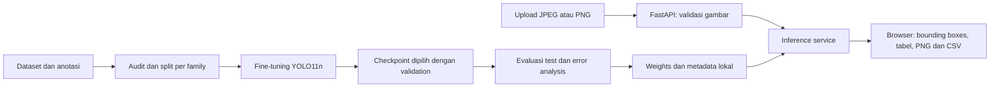

# PCB Inspect

Demo inspeksi visual PCB polos dengan YOLO11n yang di-fine-tune dan aplikasi lokal FastAPI. Upload satu gambar untuk melihat lokasi/jenis cacat, confidence, ringkasan per kelas, serta mengunduh PNG dan CSV. Proyek ini menggunakan pretrained weights COCO sebagai titik awal training; bukan model yang dilatih dari nol.

## Status

Implementasi dan verifikasi model sedang berlangsung. Angka evaluasi final akan dicatat setelah eksperimen selesai; jangan menganggap aplikasi atau akurasi model sudah terverifikasi hanya dari adanya source code. Lihat `reports/implementation-status.md` dan `reports/evaluation.json` ketika tersedia.

## Arsitektur



Web statis HTML/CSS/JavaScript dilayani oleh FastAPI dari origin yang sama. Training adalah perintah terpisah dari web. Tidak ada database, akun pengguna, atau riwayat inspeksi permanen. Jalankan satu worker pada `127.0.0.1`.

## Menjalankan pada Windows dan PowerShell

Root proyek pada mesin pengembangan: `D:\!PROJECT\!persiapan_maganghub\projects\comvis_yolo`.

```powershell
Set-Location 'D:\!PROJECT\!persiapan_maganghub\projects\comvis_yolo'
.\setup.ps1
```

Default setup memakai base Python 3.12 dan executable uv yang sudah ada di D: pada workspace ini. Pada komputer lain, berikan lokasi yang sesuai:

```powershell
.\setup.ps1 -BasePython 'D:\Tools\Python312\python.exe' -UvPath 'D:\Tools\uv.exe'
```

Path pada contoh tersebut harus diganti dengan executable yang benar-benar tersedia. `.venv` baru dibuat khusus proyek ini; paket Auto MPG/Bank Marketing tidak dipakai bersama. Tidak perlu Anaconda. Versi PyTorch CUDA dipilih untuk driver 537.70 pada RTX 3050 Laptop 4 GB; driver dan perangkat lain perlu pemeriksaan kompatibilitas.

Semua launcher memuat `scripts/project-env.ps1` untuk mengarahkan TEMP/TMP, cache installer/framework, konfigurasi YOLO, dan output proyek ke D:. Menaruh `.venv` di D: saja tidak cukup. Windows tetap dapat membaca executable/file sistem yang sudah ada di C:.

### Dataset dan pretrained weights

Download dataset dari [Kaggle Norbert Elter](https://www.kaggle.com/datasets/norbertelter/pcb-defect-dataset/data). Simpan ZIP di `data/raw/pcb-defect-dataset.zip` dan ekstrak sehingga ada `data/raw/pcb-defect-dataset/data.yaml`, `train`, `val`, dan `test`. Dataset tidak disertakan dalam Git.

```powershell
New-Item -ItemType Directory -Path 'models\base' -Force
Invoke-WebRequest -Uri 'https://github.com/ultralytics/assets/releases/download/v8.3.0/yolo11n.pt' -OutFile 'models\base\yolo11n.pt'
.\prepare-data.ps1
.\train.ps1 --smoke --batch 4
.\train.ps1 --batch 4 --epochs 40 --time-hours 1
.\evaluate.ps1 --batch 4
.\run.ps1
```

Batch 4 adalah kandidat awal, bukan jaminan VRAM cukup. Gunakan batch hasil smoke test; jika CUDA OOM, hentikan run yang gagal dan turunkan ke 2 lalu 1. Training utama berhenti pada batas 40 epoch, early stopping, atau budget satu jam, mana yang tercapai lebih dahulu. Budget waktu diperiksa setelah setiap epoch beserta validation, sehingga dapat terlewati hingga satu epoch dan final validation. Scheduler tetap mengikuti jumlah epoch yang diminta. Jalankan evaluasi setelah training untuk membuat `models/pcb-best.pt` dan `models/model-metadata.json`. Tanpa checkpoint PCB yang valid, web menunjukkan model belum siap dan mengembalikan HTTP 503.

Buka [aplikasi lokal](http://127.0.0.1:8000). Gunakan foto PCB polos yang menyerupai contoh data, lalu periksa temuan secara manual. API interaktif tersedia di `/docs`.

### Pemeriksaan kode

```powershell
. .\scripts\project-env.ps1
& $ProjectPython -m pytest -q
node --test tests/frontend.test.mjs
```

Node hanya dibutuhkan untuk tes helper frontend; aplikasi tidak membutuhkan npm build atau framework frontend.

## Data dan evaluasi

- Dataset asli: 10.668 gambar, 21.664 anotasi dan enam kelas. Pemeriksaan lokal menemukan 2.667 nama label `_256` yang perlu dipasangkan dengan gambar `_600`.
- Koreksi diterapkan pada data turunan. Raw data dan ZIP tetap dipertahankan. Visualisasi anotasi tersedia lokal di `reports/visuals/`.
- Split baru: **5.856 train, 2.112 validation, 2.700 test**. Pengelompokan memakai family nama sumber `light_##`; semua rotasi/varian family yang sama tetap pada satu split. Tidak ada hash file identik yang melewati split pada audit lokal.
- Validation memilih checkpoint dan confidence. Test digunakan untuk evaluasi akhir setelah pilihan tersebut dibekukan.
- Laporkan mAP50/mAP50-95 serta precision, recall dan F1 pada threshold yang dipilih dari validation. Pengelompokan ini berbeda dari split bawaan Kaggle, sehingga skor tidak boleh dibandingkan langsung dengan hasil proyek lain yang memakai split berbeda.

## Kelas dan batas kemampuan

| ID | Kelas | Makna ringkas |
|---:|---|---|
| 0 | mouse_bite | Bagian tepi jalur seperti terkikis |
| 1 | spur | Tonjolan jalur yang tidak semestinya |
| 2 | missing_hole | Lubang pad yang hilang |
| 3 | short | Sambungan tak semestinya antarjalur |
| 4 | open_circuit | Jalur yang terputus |
| 5 | spurious_copper | Sisa tembaga yang tidak semestinya |

Model menilai tampilan visual, bukan kontinuitas listrik, multilayer PCB, solder, atau komponen rakitan. Confidence bukan probabilitas PCB lolos/gagal QC. “Tidak ada cacat terdeteksi” dapat berarti cacat terlewat. Gambar blur, sudut/pencahayaan berbeda, cacat sangat kecil, dan pola PCB baru dapat menurunkan hasil.

Input dibatasi JPEG/PNG, 10 MiB, dan 25 megapiksel. Server memproses hasil dalam memori request; browser menyediakan unduhan. File sementara framework berada di D: melalui launcher.

Lokasi unduhan PNG/CSV mengikuti pengaturan browser, terpisah dari TEMP/cache server. Atur folder unduhan browser ke D: agar file ekspor juga tersimpan di sana.

## Atribusi dan redistribusi

Dataset Kaggle mengatribusikan sumber kepada R. Ding, L. Dai, G. Li dan H. Liu, *TDD-Net: A Tiny Defect Detection Network for Printed Circuit Boards*, 2019, DOI [10.1049/trit.2019.0019](https://doi.org/10.1049/trit.2019.0019). [Repositori terkait](https://github.com/Ixiaohuihuihui/Tiny-Defect-Detection-for-PCB) menjelaskan augmentasi dan pembuatan cacat sintetis.

Lisensi pada halaman Kaggle tertulis **Unknown** saat diperiksa. Dataset, gambar sumber/hasil yang memuatnya, dan checkpoint terlatih tetap lokal sampai ketentuan redistribusinya jelas. Source code dan laporan agregat tersedia pada repo ini. Ultralytics memiliki [ketentuan lisensi tersendiri](https://www.ultralytics.com/license).

Panduan visual memakai [industrial-brutalist-ui](https://github.com/Leonxlnx/taste-skill-classics), dengan palet biru terang sesuai pilihan pengguna.

## Membaca proyek

- [System design](docs/superpowers/specs/2026-10-25-pcb-inspection-design.md)
- [Implementation plan](docs/superpowers/plans/2026-10-25-pcb-inspection-plan.md)
- [Panduan alur kode](docs/learning-guide.md)
