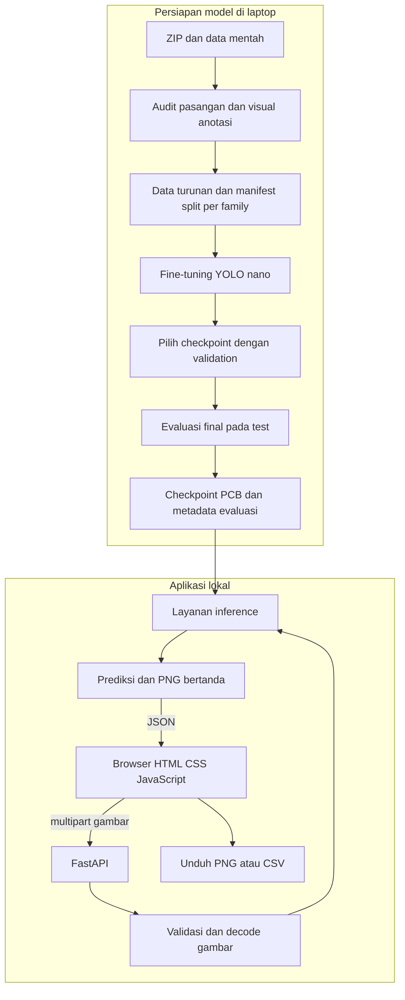

# System Design Asisten Inspeksi Visual PCB Polos

Status: Approved untuk implementasi oleh Naufal pada 25 Oktober 2026  
Pemilik: Naufal Bhanu Shidqianto  
Tanggal: 25 Oktober 2026  
Repo public: https://github.com/nbhan21/pcb-defect-detection-yolo

## 1. Ringkasan

Bangun demo lokal yang membantu pengguna meninjau cacat visual pada jalur PCB polos. Pengguna mengunggah satu gambar, model YOLO hasil fine-tuning memprediksi lokasi dan jenis cacat, kemudian web menampilkan gambar bertanda, confidence, dan ringkasan temuan. Pengguna dapat mengunduh gambar PNG dan tabel CSV.

Proyek merupakan portfolio dengan eksperimen model dan integrasi aplikasi yang dapat dijelaskan Naufal. Hasil eksperimen adalah bukti performa pada pembagian dataset yang dicatat; demo tidak menjamin kelayakan elektrik PCB atau menggantikan pemeriksaan QC.

## 2. Tujuan dan Batasan

Keputusan pengguna yang sudah disepakati:

- Objek inspeksi adalah PCB polos yang menyerupai dataset, dengan enam kelas cacat.
- Model dibuat lewat fine-tuning pretrained YOLO, bukan hanya inference model umum.
- Aplikasi menggunakan FastAPI dengan HTML, CSS, dan JavaScript.
- Input satu gambar per proses; hasil tampil dan dapat diunduh. Hasil tidak menjadi riwayat permanen.
- UI mengikuti industrial-brutalist dengan biru dominan dan background terang.
- Environment, data, model, cache, temporary, dan hasil proyek ditempatkan di drive D:.

Demo inti selesai bila training menghasilkan checkpoint yang dapat dimuat, evaluasi final tercatat, dan upload gambar valid benar-benar menghasilkan prediksi melalui aplikasi. Model yang hanya menampilkan kotak buatan tidak memenuhi tujuan.

Untuk versi ini, video, webcam, batch upload, Docker, hosting publik, akun pengguna, database, pemeriksaan solder/komponen, dan verdict lulus/gagal tidak dikerjakan. Notebook tidak menjadi syarat. Penjelasan keputusan, kode utama, dan hasil tetap menjadi deliverable.

## 3. Kondisi Data dan Masalah Awal

Sumber adalah Kaggle `norbertelter/pcb-defect-dataset`, diekstrak ke `data/raw/pcb-defect-dataset`. ZIP asli disimpan di `data/raw/pcb-defect-dataset.zip`. Data mentah dipertahankan.

| Fakta audit lokal | Hasil |
|---|---:|
| Gambar train bawaan | 8.534 |
| Gambar validation bawaan | 1.066 |
| Gambar test bawaan | 1.068 |
| Total gambar | 10.668 |
| Total bounding boxes terbaca | 21.664 |
| Nama gambar dan label tidak cocok | 2.667 pasangan |
| Baris label dengan format/nilai invalid pada pemeriksaan awal | 0 |
| Family nama asal `light_##` | 10 |

Sebanyak 2.667 label berakhiran `_256`, sedangkan gambar pasangannya berakhiran `_600`. Pemetaan nama dapat dibuat satu ke satu tanpa benturan. Dua sampel gambar yang diperiksa berukuran 600 x 600 piksel RGB. Pemeriksaan visual bounding boxes masih harus dilakukan; format numerik valid belum membuktikan lokasi anotasi benar.

Seluruh family `light_01`, `light_04` sampai `light_12` ditemukan pada ketiga split bawaan. Ada varian `l_`, `rotation_90_`, dan `rotation_270_`. Istilah family di sini adalah pengelompokan berdasarkan nama sumber, bukan klaim bahwa identitas fisik setiap papan telah diverifikasi.

Mapping kelas mengikuti `data.yaml` asli:

| class_id | Nama kelas |
|---:|---|
| 0 | mouse_bite |
| 1 | spur |
| 2 | missing_hole |
| 3 | short |
| 4 | open_circuit |
| 5 | spurious_copper |

Halaman Kaggle menyatakan lisensi Unknown dan mengatribusikan dataset kepada karya TDD-Net. Sumber terkait menjelaskan cacat sintetis dan augmentasi. Catat atribusi dan batasan ini di dokumentasi. Dataset, sampel sumber, dan checkpoint yang dilatih darinya tetap lokal selama izin redistribusinya belum jelas. Repo public berisi kode, konfigurasi, diagram, dan laporan agregat; jangan mengasumsikan lisensi repo aplikasi memberikan hak atas dataset.

## 4. Arsitektur

| Komponen | Tanggung jawab | State atau penyimpanan |
|---|---|---|
| Persiapan data | Audit, pemetaan nama, visualisasi label, manifest split | File lokal di D: |
| Training dan evaluasi | Fine-tuning, pemilihan checkpoint, metrik dan contoh error | Runs, laporan, dan weights lokal |
| FastAPI | Menyajikan frontend dan endpoint inspeksi dari satu origin | Satu proses lokal |
| Layanan inference | Memuat checkpoint sekali, menjalankan prediksi dan menggambar kotak | Model dalam RAM/VRAM |
| Frontend | Upload, preview, kondisi proses/error, tabel dan unduhan | Hasil aktif dalam memori browser |

Aplikasi mengikat `127.0.0.1` dan berjalan dengan satu worker. Training dijalankan melalui perintah terpisah. Frontend tidak memiliki tombol yang memicu training. Satu origin menghindari kebutuhan layanan frontend terpisah dan konfigurasi CORS untuk MVP.

## 5. Siklus Data dan Model

1. Audit data mentah, inspeksi kotak pada sampel lintas kelas dan varian, serta verifikasi pemetaan label. Semua koreksi dilakukan pada data turunan; data mentah tidak ditimpa.
2. Buat manifest eksplisit untuk train/validation/test berdasarkan family `light_##`. Default usulan: 6 family train, 2 validation, dan 2 test, dipilih deterministik dengan seed 42 sebelum eksperimen. Semua transformasi dan crop dengan family sama mengikuti split yang sama. Persentase jumlah gambar akan mengikuti ukuran family, bukan harus persis 60/20/20.
3. Verifikasi cakupan keenam kelas dan duplikasi antar-split. Grup yang terhubung oleh duplikasi identik harus tetap di split yang sama. Jika grup tidak bisa dibuktikan terpisah, hentikan persiapan untuk diagnosis; jangan diam-diam kembali ke random split per gambar. Bekukan manifest sebelum training dan simpan hash serta alasan pengelompokannya.
4. Mulai dari `yolo11n.pt` pretrained COCO sebagai usulan baseline. Sesuaikan keluaran untuk enam kelas PCB dan fine-tune seluruh layer yang dapat dilatih dengan arsitektur standar. Model umum tersebut belum merupakan detector cacat PCB.
5. Jalankan smoke test kecil untuk memastikan data dan GPU bekerja. Tetapkan batch size, jumlah epoch, dan pin paket dalam implementation plan berdasarkan kompatibilitas serta uji VRAM; angka tersebut belum dijanjikan di desain ini. Ukuran awal yang diusulkan 640 piksel dan cache dataset dinonaktifkan.
6. Jalankan satu baseline utama. Gunakan validation untuk memilih checkpoint dan pengaturan confidence. Evaluasi test setelah pemilihan selesai. Jangan memakai hasil test untuk memilih checkpoint atau tuning.
7. Laporkan precision, recall, mAP50, mAP50-95, hasil per kelas, serta contoh false positive, false negative, salah kelas, dan kotak yang meleset. Confidence bukan peluang bahwa PCB pasti cacat. Nilai performa dan durasi belum tersedia.

Checkpoint hanya dipromosikan ke aplikasi setelah jumlah/urutan kelas dan pipeline inference diverifikasi. Metadata menyertakan identitas checkpoint, hash, versi paket, konfigurasi training, dan manifest data. Uji integrasi lebih awal boleh memakai checkpoint hasil smoke test yang diberi label sementara; demo akhir memakai checkpoint yang telah dievaluasi.

## 6. Kontrak API dan Data

Usulan kontrak minimum untuk memisahkan pekerjaan frontend dan backend:

| Endpoint | Input | Hasil |
|---|---|---|
| `GET /api/health` | Tidak ada | Kesiapan model, identitas checkpoint, dan device aktual; HTTP 503 bila model belum siap |
| `POST /api/inspect` | Multipart `image`, opsional `confidence` | JSON berisi ukuran gambar, prediksi, jumlah per kelas, waktu inference, metadata model, dan PNG bertanda sebagai data URI |

`confidence` memiliki default awal 0.25 dan rentang 0.05 sampai 0.95. Nilai default akhir dipilih menggunakan validation dan dicatat. Mengubah slider di web memerlukan inspeksi ulang agar gambar, tabel, dan CSV berasal dari hasil yang sama.

Setiap deteksi berisi `class_id`, `class_name`, `confidence`, dan `bbox_xyxy`. Koordinat keluaran adalah piksel pada gambar input yang sudah dinormalisasi orientasinya, bukan koordinat YOLO 0 sampai 1. Backend menjaga gambar bertanda dan koordinat tabel tetap menggunakan orientasi serta ukuran yang sama.

Input menerima JPEG dan PNG, maksimum 10 MiB dan 25 megapiksel. Validasi memakai decode gambar, bukan nama ekstensi saja. File kosong/rusak diberi HTTP 400, tipe tidak didukung 415, batas ukuran 413, parameter tidak valid 422, dan checkpoint belum siap 503. Kegagalan inference menjadi error yang bisa dibaca pengguna, dengan detail teknis disimpan pada log lokal.

Tidak ada endpoint untuk riwayat atau penyimpanan hasil. Browser membuat unduhan PNG dan CSV dari response aktif. CSV memuat kelas, confidence, dan koordinat; jika tidak ada deteksi, CSV tetap memiliki header. Untuk 0 temuan, gunakan kalimat “Tidak ada cacat terdeteksi pada pengaturan ini”, bukan “PCB lolos QC”.

## 7. Pengulangan Request dan Kegagalan

Memproses gambar yang sama kembali diperbolehkan dan tidak membuat record permanen. Setiap proses menggunakan satu checkpoint aktif dan parameter request yang sama selama proses berlangsung. Memuat checkpoint berbeda memerlukan restart aplikasi.

Satu slot inference dilindungi lock. Request kedua saat slot terpakai menerima HTTP 429 dengan pesan untuk mencoba kembali; frontend menonaktifkan tombol proses selama request aktif. Tidak ada antrean background atau retry otomatis. Jika decode, model, atau inference gagal, UI mengakhiri indikator proses dan membatalkan hasil aktif agar gambar baru tidak tertukar dengan hasil lama.

Model dimuat sekali saat startup. Jika checkpoint belum ada atau mapping kelas salah, UI menampilkan model belum siap dan inspeksi ditolak. Jangan menggantinya secara diam-diam dengan pretrained COCO umum atau data prediksi buatan. Device default GPU ketika benar-benar tersedia; CPU diperbolehkan untuk inference dan harus ditampilkan sebagai device aktual. Training CPU yang berpotensi lama memerlukan peninjauan rencana jika GPU tidak dapat digunakan.

## 8. UI dan Penggunaan Lokal

UI satu halaman berbahasa Indonesia dengan nama kelas asli berbahasa Inggris. Urutannya: judul dan status model, panel upload serta parameter, preview input/hasil, ringkasan jumlah temuan, tabel detail, kemudian tombol unduh.

Pada desktop, panel kontrol di kiri dan area gambar lebih luas di kanan. Pada layar sempit, panel disusun vertikal. Preview mempertahankan rasio gambar. State kosong, file dipilih, sedang proses, berhasil dengan/ tanpa temuan, dan gagal harus terlihat jelas.

Skill `industrial-brutalist-ui` digunakan dengan penyesuaian warna yang diminta pengguna: background `#F4F7FC`, panel `#DBEAFE`, aksen `#3B82F6`, tombol utama `#1D4ED8`, serta teks/border `#111827`. Grid tegas, sudut siku, dan tipografi kuat mengacu pada referensi kedua pengguna. Palet biru menggantikan aksen merah pada skill. Warna kuning hanya boleh digunakan bila ada kebutuhan peringatan yang nyata.

Foto PCB dan gambar hasil tidak diberi scanlines, grain, dithering, atau filter dekoratif. Tidak ada angka telemetry, confidence, atau status model palsu. Nama kelas pada kotak dan tabel harus terbaca. Tombol mendukung keyboard, label form jelas, dan status proses/error tidak disampaikan dengan warna saja.

## 9. Environment dan Privasi

Root proyek adalah `D:\!PROJECT\!persiapan_maganghub\projects\comvis_yolo`. Buat `.venv` khusus menggunakan Python yang sudah tersedia di D:. Paket proyek dipisahkan dari environment Auto MPG dan Bank Marketing. Anaconda tidak diperlukan.

Launcher PowerShell mengatur cache paket, cache framework, konfigurasi YOLO, matplotlib, temporary, dan output ke `.local` atau folder proyek di D: sebelum proses dijalankan. Windows dan executable yang sudah terpasang mungkin tetap membaca file sistem di C:; targetnya adalah seluruh artefak dan kebutuhan tulis proyek berada di D:.

Perangkat terverifikasi: RTX 3050 Laptop 4096 MiB, driver 537.70. Gunakan wheel PyTorch/CUDA yang sesuai dengan driver; jangan mengambil build terbaru tanpa verifikasi atau memasang beberapa toolkit CUDA. Pembaruan driver tidak menjadi langkah otomatis. Pin versi paket setelah smoke test.

Request dan response diproses di memori. Multipart mungkin menggunakan file sementara, sehingga `TEMP` dan `TMP` harus diarahkan ke D: sebelum server berjalan. Jangan menyimpan upload, hasil inspeksi, nama/path pribadi, atau isi gambar sebagai log permanen. Dataset, ZIP, `.venv`, cache, checkpoint, dan kredensial dikecualikan dari Git.

## 10. Verifikasi dan Kriteria Penerimaan

| Area | Bukti yang wajib tersedia |
|---|---|
| Data | Pasangan gambar/label cocok, visual kotak diperiksa, mapping kelas benar, manifest family disjoint, dan duplikasi lintas split ditangani |
| GPU | Versi aktual, CUDA tersedia atau diagnosis jelas, serta smoke training berhasil pada setting yang dicatat |
| Model | Checkpoint dapat dimuat, enam kelas sesuai urutan, metrik test aktual dan error analysis tersimpan |
| API | JPEG/PNG valid menghasilkan prediksi aktual, serta file kosong, rusak, tipe lain, oversize, dan model tidak siap ditangani |
| Frontend | Upload sampai hasil teruji di browser; preview, jumlah, confidence, tabel, dan PNG/CSV konsisten dengan response |
| Kondisi khusus | Nol deteksi, request ganda, error server, pergantian file, dan tampilan sempit teruji |
| Penyimpanan | Aplikasi tidak membuat riwayat hasil; kebutuhan tulis proyek diarahkan ke D: |
| Reproduksi | README menjelaskan environment, data, training, evaluasi, menjalankan web, dan batasan; dependensi dipin |

Target numerik mAP dan latency tidak ditentukan sebelum eksperimen. Keberhasilan aplikasi diuji terpisah dari kualitas model. Jika model masih sering salah, demo tetap menyatakan keterbatasannya dan tidak dipromosikan sebagai alat inspeksi produksi. README/CV menyebut pretrained weights yang di-fine-tune serta hasil aktual; tidak ada klaim peningkatan tanpa pembanding yang diuji.

## 11. Alternatif dan Hal yang Masih Perlu Dibuktikan

Streamlit dipertimbangkan untuk mempercepat UI. Pengguna memilih FastAPI dan frontend terpisah secara tanggung jawab agar alur request dan integrasi dapat dipelajari. Kedua bagian tetap dilayani dari satu server lokal.

Model PCB siap pakai dipertimbangkan untuk mengurangi eksperimen. Pengguna memilih fine-tuning sendiri. Database dan riwayat dipertimbangkan, lalu pengguna memilih hasil aktif yang bisa diunduh.

Hal yang diselesaikan melalui inspeksi/uji teknis, bukan tebakan atau klaim hasil: kecocokan visual label `_256`, duplikasi antar-family, kompatibilitas paket dengan driver, setting VRAM, threshold validation, dan performa test. Bila temuan teknis mengharuskan perubahan scope atau pilihan model, jelaskan bukti dan revisi desain terlebih dahulu.

## 12. Urutan Pengerjaan Setelah Desain Disetujui

1. Susun implementation plan dengan pin paket dan langkah verifikasi. Mulai dari data turunan serta split, kemudian smoke test model.
2. Jalankan fine-tuning baseline, pilih checkpoint memakai validation, lalu evaluasi final dan error analysis.
3. Kerjakan frontend dan layanan inference secara paralel bila kontrak pada bagian 6 telah dibekukan. Integrasikan, uji alur penuh, dan verifikasi unduhan.
4. Lengkapi README, diagram alur, laporan hasil, dan penjelasan kode utama untuk Naufal. Pembaruan repo public mengecualikan data dan artefak yang belum jelas izin redistribusinya.

Tanggal 25 Oktober adalah kondisi saat desain ini disusun, bukan bukti demo sudah selesai. Pertahankan scope agar 26 Oktober dapat difokuskan pada CV dan berkas. Jika waktu menyempit, potong fitur tambahan; jangan mengganti hasil training/evaluasi dengan klaim yang belum dibuktikan.

## Sumber

- Dataset: https://www.kaggle.com/datasets/norbertelter/pcb-defect-dataset/data
- Sumber TDD-Net terkait: https://github.com/Ixiaohuihuihui/Tiny-Defect-Detection-for-PCB
- Model YOLO11: https://docs.ultralytics.com/models/yolo11/
- Training: https://docs.ultralytics.com/modes/train/
- Format label: https://docs.ultralytics.com/datasets/detect/#ultralytics-yolo-format
- PyTorch wheels versi sebelumnya: https://pytorch.org/get-started/previous-versions/
- Referensi UI: https://github.com/Leonxlnx/taste-skill-classics/tree/main/skills/brutalist-skill

Format resmi dokumentasi proyek ini adalah Markdown (.md), sesuai pilihan pengguna. Struktur topik mengadaptasi referensi System Design; PDF dan Word tidak menjadi deliverable yang diperlukan.
